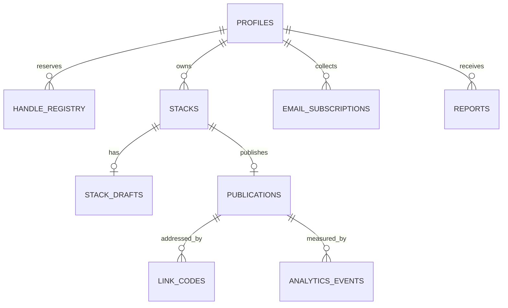

# Project Louie — Data model and operation boundaries

Status: Technical design for implementation review, updated October 9, 2026 after final review. No migrations or application code exist yet.

Sources: [product.md](../product.md) and [product-rules.md](../product-rules.md). If this document conflicts with them, the product documents win and this one must be corrected.

## Core identities

- A **stack** is the creator's working object.
- A **publication** is a stack's current published content. It is the unit for analytics and keeps its identity through republishing and privacy changes.
- A **draft** is unpublished work: either a new stack that hasn't been published, or the edit draft of a published one.
- A **link code** is the random part of a stack's viewer URL. It can be revoked independently of the publication.

## Relationships



A stack has at most one publication and at most one draft.

## Records

### profiles

| Field | Type / constraint | Purpose |
| --- | --- | --- |
| id | UUID, primary key referencing the auth user | Creator identity |
| handle | Unique, `^[a-z0-9._]{2,30}$` | Current public handle |
| handle_changed_at | Nullable timestamp | Enforces one change per 30 days |
| display_name | Nonempty, at most 50 characters | Attribution |
| bio | Optional, at most 160 characters | Provisional until the profile design lands |
| avatar_path | Optional storage path | Profile picture; upload rules wait on the profile design |
| links | Validated JSON | Social and website links (reuse Stack's `socials.ts` field set and validation) |
| status | active / suspended | Admin takedown |
| revision | Integer, starts at 1 | Detects stale profile saves |
| created_at, updated_at | Timestamps | |

Auth email and credentials stay in Supabase Auth.

### handle_registry

One shared registry enforces uniqueness for current, retired and deleted-account handles. `handle` is the primary key; `profile_id` is nullable and uses `ON DELETE SET NULL`; `state` is current / retired / reserved; timestamps record reservation and retirement. One current handle per live profile. Signup and handle changes claim names transactionally in this registry, including reserved application route names.

Live retired handles redirect to the profile’s current handle. Account deletion makes all its handles reserved and clears their profile references without deleting reservations. A deleted account’s handles show unavailable, never redirect to unrelated content.

### deleted_stack_ids

Keeps only the deleted stack UUID and deletion timestamp permanently. Every first-save operation rejects a reserved deleted ID. No content or creator address is retained. This prevents a delayed initial save from recreating a deleted stack after normal rows have been removed.

### stacks

| Field | Type / constraint | Purpose |
| --- | --- | --- |
| id | UUID primary key, supplied by the client on first save | Working identity; a retried create converges on the same row |
| owner_id | FK to profiles | Ownership |
| created_at, updated_at | Timestamps | Owner list ordering |

### stack_drafts

| Field | Type / constraint | Purpose |
| --- | --- | --- |
| id | UUID primary key | Draft identity |
| stack_id | FK, unique | One draft per stack |
| content | Validated JSON ([content format](#content-format)) | Title, description and body |
| revision | Integer, starts at 1 | Stale-save detection |
| proposed_visibility | Nullable public / unlisted / private | Defaults to public for new drafts; null for edit drafts |
| base_content_revision | Nullable integer | For edit drafts: the publication revision the draft was opened from |
| created_at, updated_at | Timestamps | |

An edit draft of a live publication never stores visibility; privacy comes from the publication, so an old draft can't undo a privacy change.

### publications

| Field | Type / constraint | Purpose |
| --- | --- | --- |
| id | UUID primary key | Analytics identity |
| stack_id | FK, unique | |
| visibility | public / unlisted / private | Current access |
| content | Validated JSON | What viewers see |
| content_revision | Integer | Increments on each republish |
| access_revision | Integer | Increments on each privacy change |
| last_draft_id | UUID | Most recently consumed draft, for traceability; retry safety uses mutation receipts |
| first_published_at | Timestamp | Original publication date |
| content_updated_at | Timestamp | "Last updated" date |
| search_document | tsvector, derived | Creator-page search |
| pin_position | Nullable integer | Only for public publications |
| disabled_at | Nullable timestamp | Admin takedown |

### link_codes

| Field | Type / constraint | Purpose |
| --- | --- | --- |
| code | Primary key, 10 characters from `a–z` and `2–9`, excluding `i`, `l` and `o` | The random part of the URL |
| publication_id | Nullable FK | The publication it opens; cleared when the stack is deleted |
| created_at | Timestamp | |
| revoked_at | Nullable timestamp | Permanent revocation |

- Codes are generated with a cryptographically secure random generator. Ten characters from the 31-symbol alphabet give about 8 × 10^14 combinations. Combined with rate limiting on stack lookups, that makes guessing infeasible.
- At most one unrevoked code per publication (partial unique index).
- A live public or unlisted publication has exactly one active code. A private publication has none.
- Revoked codes are never deleted or reissued, even after the stack is deleted, so an old URL can never open different content.

### Readable URLs

The canonical stack URL is `/{current handle}/{slug(current title)}-{active code}`. The slug is derived when the page is served, never stored. Lookup uses only the code. After access is validated, a URL with an outdated handle or slug redirects to the canonical form using a temporary, no-store redirect so browsers recheck access and later title changes. A URL with a revoked or unknown code shows "This stack isn't available."

### email_subscriptions

| Field | Type / constraint | Purpose |
| --- | --- | --- |
| id | UUID primary key | |
| creator_id | FK to profiles | Which creator's list |
| email | Normalized (trimmed, lowercased domain) | Address |
| status | pending / active | Double opt-in state |
| subscribed_at | Timestamp | Most recent form submission |
| confirmed_at | Nullable timestamp | When the subscriber confirmed |
| last_confirmation_sent_at | Nullable timestamp | Limits resends |

Unique on (creator_id, email). Dots and plus signs in the address are kept as entered.

### subscription_tokens

Stores hashed tokens with a purpose (confirm / remove) and expiry; confirmation tokens expire after 7 days. Raw tokens appear only in email delivery. Removal links require a confirmation action, delete the subscription and all its tokens, and are inaccessible afterward. Token GET requests never mutate state. Owner address deletion uses the same transaction.

Repeated signup never downgrades active subscriptions. Resend delivery occurs outside the database transaction: reserve a rate-limited send attempt, mark successful delivery only after acceptance by Resend, and handle failed delivery/retries without duplicating or falsely activating a subscription.

### analytics_events

| Field | Type / constraint | Purpose |
| --- | --- | --- |
| id | Bigint identity | |
| creator_id | FK | |
| publication_id | Nullable FK | Null for creator-page views |
| kind | view / link_click | |
| visitor_id | Nullable UUID | From the first-party cookie; null when there's no consent |
| url | Nullable text | For link_click: the URL clicked |
| occurred_at | Timestamp | |

Events are accepted only for currently accessible active creator pages/publications, never owner visits. Link-click URLs must belong to the current authorized published snapshot and use the same normalization as rendering. Validate consent state; rate-limit visitors without identifiers by other safe request limits.

Raw events are kept for 90 days, then deleted by scheduled cleanup. V1 exposes only 7/30-day ranges, with distinct visitor IDs across each complete range. No daily unique-count summation or indefinite rollup. Click history for removed URLs remains within the range; stack/account deletion deletes associated events. Consent and measurement coverage follow the user-flow specification.

### reports

| Field | Type / constraint | Purpose |
| --- | --- | --- |
| id | UUID primary key | |
| creator_id | FK | Reported creator |
| publication_id | Nullable FK | Reported stack, if any |
| reason | malicious_link / spam / adult / other | |
| details | Optional, at most 500 characters | |
| reporter_email | Optional | For follow-up |
| status | open / actioned / dismissed | Admin review state |
| created_at | Timestamp | |

### admin_actions

Records every takedown and reversal: admin user ID, action (disable_stack, enable_stack, suspend_creator, restore_creator, dismiss_report), target, optional report ID, and time. Admins are listed in a server-side allowlist.

## Content format

Louie uses Stack's content format as version 1, so the Create Stack flow carries over unchanged. Reference: Stack `web/src/lib/types.ts` (`Section`, `Line`) and the normalization in `web/supabase/migrations/20261011000000_link_only_lines.sql`.

```json
{
  "schema_version": 1,
  "title": "Three days in Tokyo",
  "description": "Where I ate, walked and stayed.",
  "sections": [
    {
      "label": "Day 1 — Shibuya",
      "lines": [
        {
          "format": "num",
          "text": "Coffee at **Blue Bottle**, then walk to miyashita-park.jp",
          "link": "https://bluebottlecoffee.jp",
          "linkName": "Menu",
          "linkNames": { "miyashita-park.jp": "Park" }
        }
      ]
    }
  ]
}
```

- `format` is `num`, `bullet` or `text`. Stack's legacy `bold` format, the per-line `bold` flag and the separate `note` field are not part of Louie.
- Bold words are wrapped in `**` inside `text`.
- Web addresses typed into `text` show as link pills; `linkNames` optionally names them.
- `link` is one optional attached link with an optional `linkName`.
- Links must be http(s), without whitespace, at most 2,048 characters, with a dotted host. The client and the database apply the same rule.
- No HTML is accepted.

Link clicks are attributed by URL within a publication. If a URL appears twice in one stack, its clicks are combined; if the creator changes a URL, the new one starts at zero. Line and link IDs can be added in a later schema version if per-link history is needed.

### Limits and counting

| Field | Limit |
| --- | --- |
| Title | 60 characters; required to publish |
| Description | 180 characters; optional |
| Section heading | 60 characters |
| Sections | 20 |
| Lines | 100 |
| Line text | 360 characters, not counting `**` marks |
| Link name | 40 characters |
| Attached link URL | 2,048 characters |
| Total | 6,000 characters |

The total counts the title, description, section headings and line text (excluding `**` marks). Addresses typed into line text count because they are text. Attached link URLs and link names don't count. The limits come from Stack `web/src/lib/format.ts`. Client and database validators must implement the same versioned rules. Count Unicode code points consistently (not JavaScript UTF-16 code units), with shared examples covering emoji, bold markers, URLs and link-only lines. Matching constants alone is insufficient. URL normalization and link-name lookup must agree across editor, renderer and analytics.

Validation functions, versioned with the schema: `validate_content_v1`, `has_draft_content_v1` (title, description or a nonempty line), `can_publish_content_v1` (title plus a line with text or a link) and `content_text_count_v1`.

## Operations

Each operation runs as one database transaction. Locks are taken in the same order every time: stack, then publication, then draft. Row locks serialize the work; revision checks decide whether a request is stale.

| Operation | Behavior |
| --- | --- |
| Create draft | First nonblank save. Inserts stack and draft using the client’s stack ID. Checks deleted ID reservations. Retries use the original mutation receipt, never recreate a consumed/deleted draft. |
| Open edit draft | Returns the existing edit draft, or copies the publication's content into a new one with `base_content_revision`. Concurrent opens get the same draft. |
| Save draft | Requires the draft ID and expected revision. Saves and increments the revision. A missing draft or wrong revision returns a conflict, never a new draft. |
| Publish new stack | Checks publish rules and link safety. Creates the publication, issues a code if public or unlisted, records `last_draft_id`, deletes the draft. A retry after a lost response uses its mutation receipt and cannot change a later publication. |
| Republish | Requires the expected draft and content revisions. Replaces the content, increments `content_revision`, keeps the code and analytics, deletes the draft. Retries use mutation receipts; consumed drafts are never silently recreated. |
| Change privacy | Requires expected access revision. Applies immediately. Public ↔ unlisted keeps the code. To private: revokes the code and clears the pin. Private → public or unlisted: issues a new code. Choosing the current visibility changes nothing. |
| Delete stack | Rechecks the confirmed content/access/draft revisions; changed work requires fresh confirmation. Reserves the deleted stack ID, revokes its codes, then deletes publication, draft, analytics and stack atomically. Identical retries return their receipt. |
| Delete draft | Deletes the exact draft revision. The publication is untouched. A later save to that draft gets a conflict. |
| Change handle | Rejects if the last change was under 30 days ago or the handle is taken or retired. Retires the old handle and claims the new one in `handle_registry` atomically. |
| Submit subscription | Rate-limited and protected by Turnstile. Creates or refreshes a pending row, preserves existing active status and reserves a rate-limited email attempt; never reveals existing status. |
| Confirm subscription | Explicit POST with valid unexpired token → status active; GET is read-only. |
| Remove subscription | Owner deletion or subscriber removal-token confirmation deletes address and tokens; future exports exclude it. |
| Delete account | Removes profile, owned content, events, addresses/tokens and media; revokes links, reserves handles/stack IDs and invalidates sessions. |
| Set pins | Validates that every ID is the owner's live public publication and replaces the order atomically. |

## Access

| Data / action | Anonymous viewer | Owner | Other signed-in user |
| --- | --- | --- | --- |
| Creator public page | Public fields | Same, plus owner tools | Public fields |
| Creator's public stack list and search | Live public publications | Same | Live public publications |
| Stack by valid code | Published content | Published content | Published content |
| Private stack | Unavailable | Through owner routes | Unavailable |
| Drafts and Manage | Denied | Own only | Denied |
| Analytics, subscribers, CSV | Denied | Own only | Denied |
| Submit subscription or report | Allowed | Allowed | Allowed |

Suspended creators and disabled stacks are unavailable publicly, including search, previews, images, event submission and subscriptions. Owners retain authenticated inspect/download/delete access. Publishing, republishing and public sharing of affected content are denied until restored; owner access never mints a public link.

Raw tables are not readable or writable from the browser. Public reads go through narrow functions that return only what the viewer may see. The service-role key stays on the server.

## Worked example

1. Maya saves "Tokyo itinerary": stack S1 and draft D1 are created. There is no link yet.
2. She publishes it as public: publication P1 and code `k7q2m9xd4p` are created. The URL is `/maya/tokyo-itinerary-k7q2m9xd4p`.
3. She renames it "Three days in Tokyo" and republishes. The URL becomes `/maya/three-days-in-tokyo-k7q2m9xd4p`; the old one redirects.
4. She makes it unlisted. The code stays, and it leaves her page.
5. She makes it private. `k7q2m9xd4p` is revoked forever.
6. She makes it public again. A new code, `w3n8c5hj2r`, is issued; P1 keeps its analytics.
7. She changes her handle to `mayatravels`. `/maya` and every old stack URL with a live code redirect to the new handle.
8. She deletes the stack. `w3n8c5hj2r` stops working; P1, its draft and its analytics are deleted.

## Verification required before acceptance

| Scenario | Required result |
| --- | --- |
| Two tabs open Edit at once | One shared draft |
| Two tabs save the same revision | One succeeds; the other gets a conflict |
| Autosave arrives after publish or delete | No draft is recreated |
| Publish response lost and retried | Same result; no duplicate publication or code |
| Public → unlisted → public | Same code throughout |
| Any → private → public | Old code dead; new code works |
| Privacy change while an edit is open | Draft unchanged; republish can't undo the privacy change |
| Rename, then open an old URL | Redirects to the new canonical URL |
| Handle change, then open `/old-handle` and an old stack URL | Both redirect |
| Second handle change within 30 days | Rejected |
| Another creator claims a retired handle | Rejected |
| Delete stack, then open its URL | Unavailable; code never reissued |
| Anonymous raw API access | No unlisted, private, draft, subscriber or analytics data |
| Repeated subscription to the same creator | One row; response doesn't reveal status |
| Owner views own stack | No analytics event |
| Unsafe link in a stack | Publish blocked with an explanation |

Run these against the real database roles, grants and functions, not only mocks.

References:
- [Supabase Row Level Security](https://supabase.com/docs/guides/database/postgres/row-level-security)
- [Supabase database functions](https://supabase.com/docs/guides/database/functions)
- [PostgreSQL row locking](https://www.postgresql.org/docs/17/explicit-locking.html)

## Mutation receipts and final-review checks

Each mutation carries a UUID action ID, scoped to authenticated actor and operation, with a payload fingerprint. Commit the successful result receipt atomically with its changes. Identical retries return the recorded result; different payload reuse is rejected. Revision checks still reject stale new actions. Keep receipts for the supported retry window (at least 90 days); expired action IDs require state reconciliation and are never silently replayed. Deleted stack IDs stay reserved permanently.

Verification additionally covers: a delayed first save after deletion; old publish/privacy retries after a newer action; concurrent handle signup/change; account deletion retaining reservations; scanner GETs leaving subscriptions unchanged; removal excluding future exports; active signup preserving active state; and every public surface rejecting disabled/suspended content while owner inspect/download/delete remains available.
