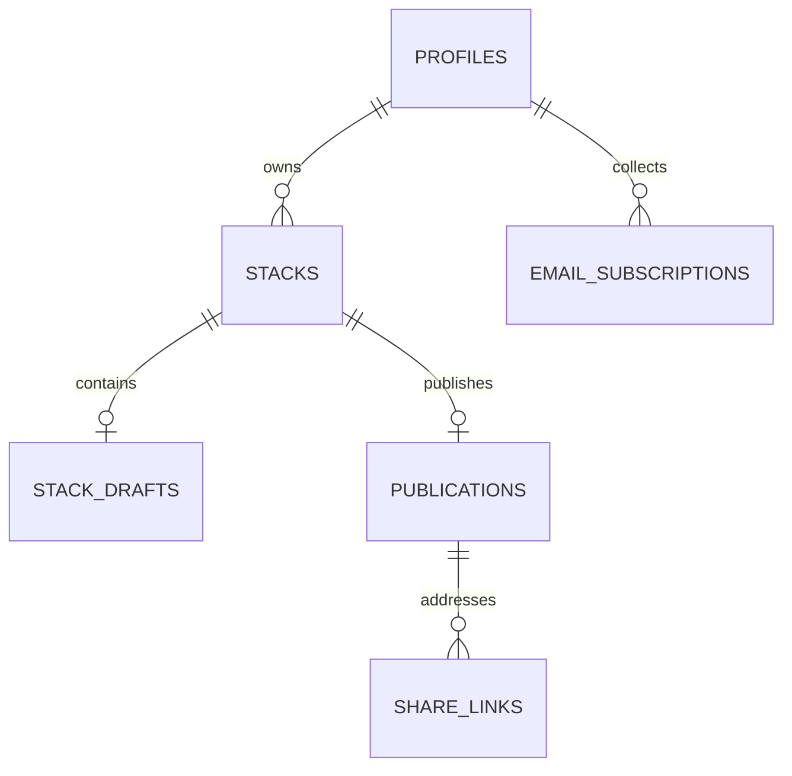

# Project Louie — Data model and operation boundaries

Status: Technical design proposal for implementation review. No migrations or application code are implemented by this document.

## Purpose and authority

Define how Louie stores content and enforces the agreed behavior before adapting Stack code.

Sources: [product.md](../product.md), [product-rules.md](../product-rules.md), and the user-flow decisions confirmed on October 9, 2026. The repository product documents currently lag several of those decisions; the confirmed updates below take precedence until they are synchronized.

Confirmed updates:
- Publish requires a title and at least one body item. Nonblank drafts autosave.
- New-stack visibility defaults to public; owner home defaults to private view. These defaults are unrelated.
- Omit location and tags.
- Editing starts at Body and proceeds to Finalize; Preview is optional for edits.
- Creator page supports search and pinning, with no featured-stack feature. Revised profile layout is deferred.
- Privacy changes take effect immediately. Changed visibility into public/unlisted generates a fresh viewer link; revoked links stay inactive.
- Story exports retain a five-page cap and use taller content areas. The cap supersedes the earlier full-content export requirement.
- Collect viewer email subscriptions on creator pages and support creator-owned CSV export. Newsletter sending and provider integrations are deferred.
- Analytics metric definitions and storage implementation are a separate design task.

The designs below implement those rules. Technical choices are recommendations, not claims about existing Louie behavior.

## Core identities

A **stack** is an owner-controlled working object. A **publication** is its current published content and the stable unit for analytics. A **draft** is unpublished work. A **share link** is a revocable viewer entry point.

Use different identifiers for these responsibilities:
- stack_id: internal working object, never sufficient to grant anonymous access.
- publication_id: stable across ordinary content republishing and privacy changes.
- draft_id + revision: saved editing instance and its concurrency version.
- share token: random viewer URL identifier; revoked independently of publication_id.

Ordinary republishing does not create another publication or reset analytics. Publishing a surviving draft after deletion creates a new stack and publication, with new analytics identity and a new link.

## Relationships

Each stack has at most one active publication and one shared draft. A deleted publication leaves a metadata record; its content is removed. A surviving draft stays associated with the original stack until republished as a new stack.

## Proposed records

### profiles

| Field | Type / constraint | Purpose |
| --- | --- | --- |
| id | UUID, primary key referencing authenticated user | Creator identity |
| handle | Normalized text, unique | Public creator URL |
| display_name | Nonempty text | Public attribution |
| bio | Optional text | Retained as provisional profile field |
| avatar_path | Optional text | Profile image reference; upload policy deferred |
| external_links | Validated JSON array | Social/website links with stable IDs and labels |
| revision | Positive bigint | Prevent stale profile saves |
| created_at, updated_at | UTC timestamps | Audit and ordering |

Keep authentication email and credentials in the authentication system, not the public profile projection. Avatar workflow, exact profile fields, and handle-change redirect rules need their own specification.

### stacks

| Field | Type / constraint | Purpose |
| --- | --- | --- |
| id | UUID, primary key | Internal working identity |
| owner_id | UUID FK to profiles, immutable through client operations | Ownership |
| lifecycle | active / retired | Retire an old container after its surviving draft moves |
| created_at | UTC timestamp | Owner list ordering |
| updated_at | UTC timestamp | Owner list ordering |

Do not store a duplicated published content copy on this row. Privacy belongs to the publication or new-stack draft, not an ambiguous global status field. Retired containers cannot accept new saves/publications.

### stack_drafts

| Field | Type / constraint | Purpose |
| --- | --- | --- |
| id | UUID, primary key | Draft instance identity |
| stack_id | UUID FK, unique | Enforces one shared draft per stack |
| content | Validated JSONB document | Title, description, ordered body |
| schema_version | Positive integer | Explicit content format |
| revision | Positive bigint | Stale-edit detection |
| proposed_visibility | public / unlisted / private | Choice for an unpublished new stack |
| edit_of_publication_id | Optional FK | Publication this edit originated from, including a deleted publication |
| base_content_revision | Optional bigint | Publication revision used when the draft was opened |
| created_at, updated_at | UTC timestamps | Recovery and management |

For edits of a live publication, visibility comes from the current publication. Do not persist a draft privacy copy that can later undo an immediate privacy change. For new/surviving drafts, chosen visibility is publication intent and does not grant viewer access.

A draft that existed before republishing must not be recreated by a stale autosave after publishing consumed it. Saves require the exact draft_id and revision; missing IDs produce a conflict, not an implicit upsert.

### publications

| Field | Type / constraint | Purpose |
| --- | --- | --- |
| id | UUID, primary key | Stable analytics/publication identity |
| stack_id | UUID FK, unique | One publication identity for this stack |
| visibility | public / unlisted / private | Effective access |
| content | Validated JSONB, null after deletion | Current viewer content |
| schema_version | Positive integer | Rendering contract |
| content_revision | Positive bigint | Changes only when content is republished |
| access_revision | Positive bigint | Changes on visibility/link changes |
| first_published_at | UTC timestamp | Original publication date |
| content_updated_at | UTC timestamp | Last content publication |
| deleted_at | Nullable UTC timestamp | Irreversible publication deletion |
| search_document | Derived search vector, null when deleted | Creator-specific search |
| pin_position | Optional integer | Public profile ordering; exact pin policy deferred |

Deletion clears content and search data, removes pinning, and revokes links. Retain ID, ownership relationship, timestamps, and deletion state for analytics association. This is metadata retention, not a restorable copy of deleted content.

Do not cascade publication deletion into draft or analytics deletion. Routine republication replaces content; historical content-version storage is not required for launch.

### share_links

| Field | Type / constraint | Purpose |
| --- | --- | --- |
| id | UUID, primary key | Link record identity |
| publication_id | UUID FK | Target publication |
| token | Unique random URL-safe string | Viewer URL such as /s/TOKEN |
| created_at | UTC timestamp | Issued time |
| revoked_at | Nullable UTC timestamp | Permanent revocation |
| issued_access_revision | Bigint | Trace visibility generation |

Generate tokens using a cryptographically secure generator with at least 128 bits of randomness; propose 32 random bytes. No sequential IDs or handles grant unlisted access. The token must be available to the owner for copying the current URL; store it in the access-controlled link table, and exclude it from general listings/logging.

Enforce at most one nonrevoked link per publication using a partial unique index. Private/deleted publications have zero active viewer links. Do not repurpose or reactivate revoked token rows.

Viewer APIs accept tokens, not internal publication IDs. Owner routes use internal IDs plus authenticated ownership.

### email_subscriptions

| Field | Type / constraint | Purpose |
| --- | --- | --- |
| id | UUID, primary key | Subscription identity |
| creator_id | UUID FK to profiles | Creator-specific list |
| email | Validated normalized text | Delivery/export address |
| status | pending / active / unsubscribed | Explicit lifecycle |
| subscribed_at | UTC timestamp | Most recent signup time |
| confirmed_at | Nullable UTC timestamp | Confirmation evidence if required |
| unsubscribed_at | Nullable UTC timestamp | Subscription state evidence |
| signup_source | Controlled value such as creator_page | CSV attribution |
| created_at, updated_at | UTC timestamps | Record lifecycle |

Unique constraint on creator_id + normalized email. The same address can subscribe to multiple creators. Do not strip dots or plus-addressing as normalization.

Email confirmation remains a product decision. The schema supports it; it does not silently adopt double opt-in. An anonymous repeated signup must not turn an unsubscribed address into active without the agreed resubscription flow.

CSV includes email, signup date, source, and status. Default mailing-list export should include active subscribers; any broader export must clearly label status. Escape CSV cells to prevent spreadsheet formula execution. Public responses must not expose list contents or reveal another person's subscription history.

If confirmation is adopted, store expiring hashed verification tokens in a separate private token table. Unsubscribe likewise uses purpose-bound tokens. Newsletter integrations are not needed for the initial collection/export flow.

### mutation_receipts

Record owner_id, operation, request_id, payload_hash, and safe result identifiers with a unique key on owner_id + operation + request_id.

Publishing, deleting, and changing privacy use request IDs to make retries safe. Reusing a request ID with a different payload is rejected. Never store subscriber CSV content or raw secrets in receipts. Set receipt retention before implementation; receipts are not a content archive.

## Content representation

Keep one compact, schema-validated JSON document per draft/publication. With a 6,000-character text budget and no need to query every paragraph independently, separate tables for every line are unnecessary initially.

Suggested shape:
- title and description.
- Ordered sections with stable section IDs and optional headings.
- Ordered items with stable IDs and type: numbered, bullet, paragraph, or bold.
- Text represented as plain text plus validated formatting/link segments.
- Links with stable IDs, destination URL, and optional label.

Do not accept arbitrary HTML. Validate shape, lengths, formats, URLs, item IDs, and attachment/order integrity in both application and database operations. Initial stack links support HTTP/HTTPS; profile contact-link types will be specified separately.

Stable item/link IDs survive reordering and normal edits. A duplicated/new item gets a new ID. A freshly published surviving draft gets a new publication_id even if internal content IDs are preserved; analytics identity must therefore include publication_id.

Known constraints: nonblank drafts; publish requires title plus body item; 6,000 total text characters; no location/tags. Exact field limits and URL/format-mark counting remain in the content specification. “Same as Stack” is not sufficient to copy inconsistent counters.

Derive search only from current published text. Creator search filters by owner and public visibility; never index or return drafts/private/unlisted content through that endpoint.

## Database operations and concurrency

Implement each operation as a single database transaction. Do not assemble publication, link, and draft changes through separate browser writes.

Use a consistent lock order: stack, publication, draft. Serialize changes for the same stack while allowing unrelated stacks to proceed independently. Row locks serialize transactions; revision checks determine whether a user's content is stale.

### Start a stack

Keep an empty editor local. On first nonblank save, create stack + draft together, defaulting proposed visibility to public. Use a client-generated request identity to avoid duplicate creation after a retry.

### Open an edit draft

Lock the stack, verify owner and active publication, and return its existing draft. If absent, copy published content into one new draft with base_content_revision. Concurrent opens must converge on the same draft.

### Save draft

Require draft_id, expected_revision, and validated content. Update only if the revision matches, then increment it and return the saved version. Zero matched rows means conflict/unavailable, never automatic creation.

Serialize autosaves per tab; ignore late responses older than the UI's latest acknowledged version. Preserve unsaved local work when a save fails or conflicts.

### Publish a new stack

Lock stack/draft and check ownership, expected draft revision, validation, and request ID. Create publication, issue a viewer link only for public/unlisted, and consume the draft atomically.

A lost response retried with the same request ID returns the original successful result. An old-tab save after publication cannot recreate the consumed draft.

### Republish an existing stack

Require expected draft revision, expected content revision, and expected access revision. Replace publication content/search and increment content_revision; consume the draft in the same transaction. Preserve publication_id, first_published_at, and current valid link.

If privacy changed while the editor was open, refresh Finalize and require acknowledgement; do not revert it during content publication. Explicit privacy selection is a separate immediate operation, followed by rereading access_revision before publication.

### Change privacy

Verify owner, expected access revision, and request ID under the same stack lock. If unchanged, do nothing. Otherwise revoke the current link, update visibility/access_revision, and issue a fresh link if the destination is public/unlisted.

Do not write draft content. Search and profile responses apply effective visibility immediately. Any stale publish attempt sees an access conflict and must refresh.

### Delete a publication

Use expected content/access revisions and a request ID to avoid deleting a version the creator did not confirm. Revoke links, clear published content/search/pin data, and set deleted_at atomically. Keep the existing draft and analytics association.

Late publication attempts return publication-deleted and require the new-publication flow. Do not automatically restore a publication or create an edit draft after deletion.

### Delete a draft

Delete only the selected draft_id after ownership/revision checks. A stale delete must not remove a replacement/newer draft. A late autosave for that ID is rejected. The publication is untouched.

### Publish a surviving draft

Require explicit visibility selection and latest draft revision. Confirm the source publication is deleted. Create a new stack and publication, issue a new viewer link if shareable, consume the old draft, and retire the old stack container in one transaction.

Keep the deleted publication metadata for historical analytics. Fresh publication_id is the boundary for fresh analytics. Old links never redirect to the new publication.

## Access boundary

| Data/action | Anonymous viewer | Owner | Other authenticated user |
| --- | --- | --- | --- |
| Creator public profile | Public projection | Same projection + own tools | Public projection |
| Public creator stack list/search | Public publications only | Same public projection | Public publications only |
| Public/unlisted stack by valid token | Current published content | Current published content | Current published content |
| Private publication | Denied | Allowed via owner route | Denied |
| Drafts and owner management | Denied | Own records only | Denied |
| Revoked/deleted token | Unavailable | Unavailable viewer URL; use owner tools | Unavailable |
| Subscriber list/export | Denied | Own list only | Denied |
| Submit subscription | Validated endpoint | Same endpoint | Same endpoint |

Keep raw draft/publication/link/subscription tables owner-protected with Row Level Security and explicit grants. Do not grant anonymous SELECT access to all unlisted rows merely because their visibility is unlisted.

Provide narrow read operations for public lists and token resolution. Token resolution returns only the current allowed content; no raw link table enumeration. Prefer invoker functions for owner operations. A tightly scoped privileged reader, where necessary, must have explicit validation, a fixed search path, restricted execute grants, and a safe response projection.

The service role must never reach the browser. Subscription inserts also go through a constrained endpoint, not unrestricted anonymous table writes.

Initial viewer responses should avoid shared caching of stack content and token-resolution outcomes until revocation behavior is verified. A privacy change cannot recall content/images a viewer already received, but subsequent requests must recheck access. Owner data must never enter shared public caches.

## Supporting features

**Exports:** Generate story images from content the requester is entitled to read. Five-page cap, taller stack content region, readable typography, source ordering, and creator attribution. Overflow uses the current viewer link for public/unlisted stacks. Private/draft overflow copy remains a design decision; never invent a public link for them.

**Pinning:** pin_position affects only live public publications. Clear the pin on deletion or transition away from public, so old pins do not reappear unexpectedly. Pin count and UI remain deferred.

**Analytics:** Retain publication identity through normal republishing/privacy changes; never accept client events for revoked/private/deleted viewer access. Exact visitor definitions, event schema, aggregation, retention, and infrastructure remain a separate technical design. Account deletion and its effects on analytics/subscribers also require a dedicated scope decision.

## Worked example

1. Creator saves Tokyo itinerary: stack S1, draft D1 revision 1; no viewer link.
2. Creator publishes public: publication P1 content revision 1, link A; D1 is consumed.
3. Creator edits: D2 is created from P1. Viewers still see P1's old content.
4. Public → unlisted: A is revoked, B issued; P1 keeps its analytics identity.
5. Creator republishes: P1 content revision increases, B remains valid.
6. Creator opens D3, then deletes P1: B is revoked; P1 content cleared; D3 survives.
7. Creator publishes D3 as public: new stack S2, publication P2, link C; P2 analytics starts fresh.
8. A and B remain inactive. P1's historical analytics remains separate from P2.

## Verification required before implementation is accepted

| Scenario | Required result |
| --- | --- |
| Two tabs open Edit simultaneously | One shared draft |
| Two tabs save the same revision | One succeeds; the other receives conflict |
| Autosave arrives after publication/deletion | No draft recreation |
| Publish response is lost and retried | Same result; no duplicate publication/link |
| Privacy changes while an edit is open | Content unchanged; stale publish cannot revert privacy |
| Privacy rotation races with token resolution | Requests use committed access state; revoked URLs stop resolving |
| Publication deletion races with republishing | One serialized outcome; no automatic restoration |
| Published deletion with surviving draft | Draft retained, content cleared, link revoked |
| Surviving draft published | New publication/link; old analytics remains separate |
| Anonymous raw API enumeration | No unlisted/private/draft content or link tokens |
| Creator search after privacy/deletion | Only current public publications |
| Subscription repeated/cross-creator export | No duplicates; no access to another creator's list |

Test these against the real database grants/functions, not only mocked UI behavior.

## Next deliverable

Write the operation/API contracts and SQL migration proposal from this model, including exact request/response/error formats, constraints, RLS policies, and transactional functions. Reconcile the product documents with the latest flow decisions before building UI against those contracts.

Official implementation references:
- [Supabase Row Level Security](https://supabase.com/docs/guides/database/postgres/row-level-security)
- [Supabase database functions](https://supabase.com/docs/guides/database/functions)
- [PostgreSQL row locking](https://www.postgresql.org/docs/17/explicit-locking.html)
- [PostgreSQL indexes](https://www.postgresql.org/docs/current/sql-createindex.html)
